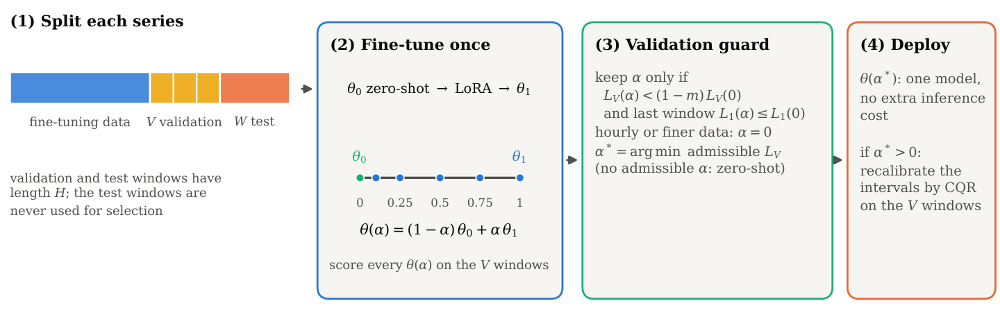

# Safe adaptation of time-series foundation models: a validation guard against harmful fine-tuning

Code, executed notebooks, per-run results and the pre-registration log for the paper

> S. Kumer and M. S. Hossain. *Safe adaptation of time-series foundation models: a validation guard against harmful fine-tuning.* Manuscript under review, 2026.

Fine-tuning a time-series foundation model (TSFM) on a small target dataset often makes it *worse* than the zero-shot model. The procedure studied here is a cheap safeguard:

1. fine-tune once (LoRA) to get weights θ₁;
2. form θ(α) = (1 − α)·θ₀ + α·θ₁ for α ∈ {0, 0.1, 0.25, 0.5, 0.75, 1};
3. score every θ(α) on held-out validation windows, and keep α > 0 only if the pooled validation loss improves by more than a margin *m* **and** the most recent window does not get worse; for hourly or finer data keep the zero-shot model (rule A, *m* = 2%);
4. deploy θ(α\*); if α\* > 0, recalibrate the prediction intervals with conformalized quantile regression on the same validation windows.



## Main results (108 runs: 3 models × 36 GIFT-Eval short-term configurations)

Change in test MWQL against the zero-shot model (negative is better), 95% cluster-bootstrap intervals:

| Method | Mean change | Worst run | No worse than zero-shot |
|---|---|---|---|
| LoRA, α = 1 | +23.4% [+8.0, +44.7] | +952% | 44/108 |
| Early stopping (best checkpoint on validation) | +5.4% [−0.0, +11.6] | +176% | 64/108 |
| +wise (α = argmin validation loss) | −2.4% [−4.2, −0.7] | +29.8% | 94/108 |
| Early stopping + guard | −0.8% [−1.8, −0.0] | +10.3% | 105/108 |
| **Rule A: interpolation + guard** | **−1.2% [−2.2, −0.4]** | **+6.9%** | **106/108** |
| Rule B: soft frequency guard | −2.6% [−4.6, −1.0] | +6.9% | 106/108 |
| Oracle (best α on test) | −4.5% | 0.0% | 108/108 |

Models: Chronos-2 (120M), TimesFM 2.5 (200M) and Chronos-Bolt base (205M). Rule A and early stopping with the same guard are statistically equivalent on average (pre-registered equivalence margin 0.5 points); plain early stopping does not bound the risk. Fine-tuning lowers the coverage of 80% intervals from 0.79 to 0.66; conformal recalibration on the validation windows restores it to 0.79.

## Repository layout

| Path | Content |
|---|---|
| `scripts/` | The three experiment scripts (Chronos-2, TimesFM 2.5, Chronos-Bolt). Each runs on a Kaggle T4 GPU and is configured by `PART` and stage flags at the top. |
| `notebooks/` | The notebooks generated from the scripts, one per Kaggle run (stage and part in the file name). |
| `runs/` | The executed notebooks with their printed logs and the CSV files they wrote, with Kaggle session ids (`runs/README.md`). |
| `results/` | The per-run CSV files used by the analysis (`results.csv`, `alpha_curves.csv` per part) and the outputs of every analysis script. |
| `analysis/` | Offline analysis: selection rules, statistical tests, figures and tables. No GPU needed. |
| `figures/` | Figures of the paper and the appendix table, as produced by the analysis scripts. |
| `docs/preregistration_log.md` | The dated study log: every pre-registration was written before the runs it describes. |
| `docs/reproduce.md` | How to re-run the experiments and the analysis. |

## Quick start (analysis only)

```bash
pip install -r requirements.txt
python analysis/stats108.py        # Table 3, bootstrap CIs and Wilcoxon tests on 108 runs
python analysis/es_E.py            # interpolation vs early stopping (pre-registered comparison)
python analysis/paper_figures.py   # figures
python analysis/appendix_table.py  # per-configuration table
```

All analysis scripts read `results/` and need only NumPy, pandas, SciPy and Matplotlib. Re-running the experiments themselves is described in [`docs/reproduce.md`](docs/reproduce.md).

## Study design in brief

The rules were developed and tested in stages, and the criteria for each confirmatory stage were written down before its runs (see `docs/preregistration_log.md`):

| Stage | Data | Outcome |
|---|---|---|
| Design | Chronos-2, 12 configurations | guard (*m* = 3%) selected |
| Seeds | same, seeds 1–2 | pass |
| Hold-out | 9 unseen configurations | **fail** (validation misled on high-frequency data) |
| Fresh sources | 7 configurations, frequency switch added | pass |
| Second model | TimesFM 2.5, 28 configurations | pass |
| Confirmation | 8 unseen configurations × 2 models | pass (rules A and B) |
| Third model | Chronos-Bolt, 36 configurations, rules frozen | pass (34/36 no worse) |
| Early stopping | all 108 runs | plain ES unsafe; ES + guard ≡ rule A; joint search no gain |

## Data

The 36 GIFT-Eval configurations ([Salesforce/GiftEval](https://huggingface.co/datasets/Salesforce/GiftEval)) are downloaded by the notebooks at run time and are not redistributed here.

## License

Code is released under the MIT License (see `LICENSE`). Result files and documentation are released under CC BY 4.0. GIFT-Eval and the pretrained models remain under their own licenses.
